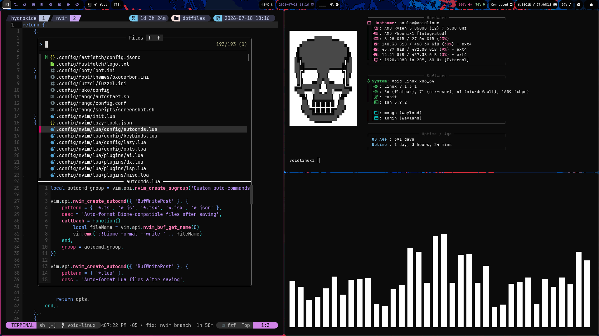

> [!NOTE]
> If you want to know more about my work, visit my **[ORCID](https://orcid.org/0009-0000-1211-9373)** (0009-0000-1211-9373) :basecamp:

### Latest Activity on GitHub :octocat:

<!--START_SECTION:activity-->
- 🍱 Pushed [08a79d2](https://github.com/hyduez/sch/commit/08a79d2755bcb88b3b01a38c125bdfee610b7af6) in [hyduez/sch](https://github.com/hyduez/sch)
- 🍱 Pushed [2ddfeb4](https://github.com/hyduez/sch/commit/2ddfeb425a2f33c1de1d0a17476776dc48b0893e) in [hyduez/sch](https://github.com/hyduez/sch)
- 🍱 Pushed [24bd23b](https://github.com/hyduez/sch/commit/24bd23b0ea8b752aabe6aba628cd770a5d01955e) in [hyduez/sch](https://github.com/hyduez/sch)
- 🍱 Pushed [390ccf0](https://github.com/hyduez/sch/commit/390ccf0ff3ccb39a22ff4613f1971206b6875db1) in [hyduez/sch](https://github.com/hyduez/sch)
- 🍱 Pushed [0a11e77](https://github.com/hyduez/sch/commit/0a11e77501c209cbaaa01e330275483ad0e367ba) in [hyduez/sch](https://github.com/hyduez/sch)
<!--END_SECTION:activity-->

  
<b>Workflow Time (My Time Working)</b>

   
  

  
<b>Desktop Screenshot (Void Linux)</b>

   
  
Here are my dotfiles: <a href="https://github.com/hyduez/dotfiles">git@github.com:hyduez/dotfiles</a>. Just another bunch of common libraries (old screenshot with river-classic)

  

  
<b>GitHub's Commit Streak</b>

   
  

Check `0x6C0F4EF2A7BF244B5FDC2DAD45289929995D9F4B` (PGP) for my SMTP/XMPP user.

###### I only land my skill sets and cv on jobs platform, here you can look at **[@dousec](https://github.com/dousec)** and **[@nosesisaid](https://github.com/nosesisaid)**. GMT-5 🇪🇨

### Featured channel I reaaly like :)

<!-- BEGIN YOUTUBE-CARDS -->

<!-- END YOUTUBE-CARDS -->
